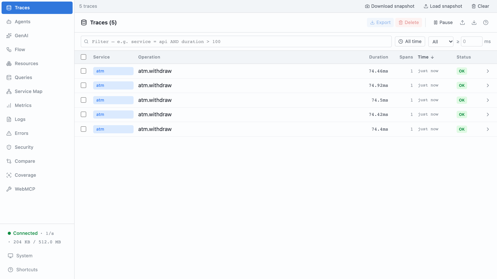
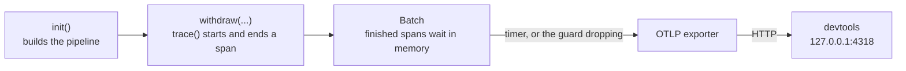
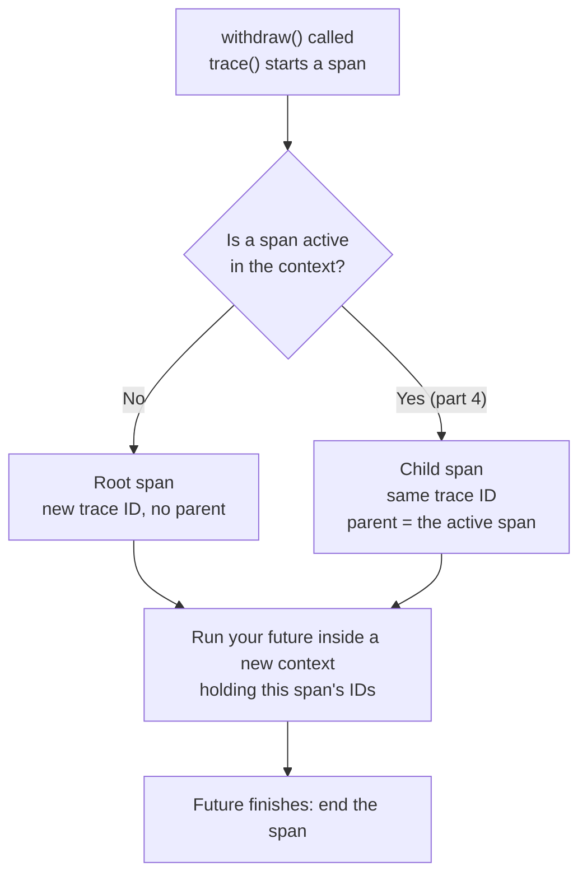
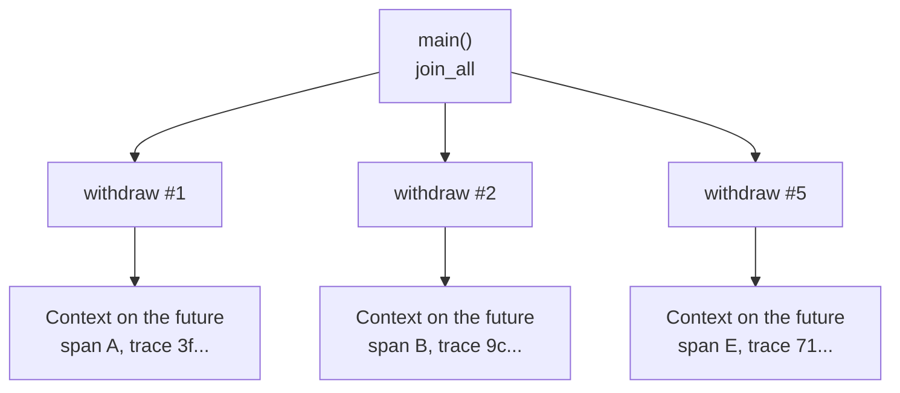

# Part 2: Your first span

## The scene

You shipped part 1's solution, and it helped. Then the Bridge Street machine
went slow again. You grepped one withdrawal out of the noise, and this was the
whole record of eleven seconds:

```json
{
  "withdrawal_id": "9f2c41aa",
  "event": "withdrawal.completed",
  "duration_ms": 11004
}
```

You need the same record with each step timed and nested inside the
withdrawal, and you would rather not write and maintain that code yourself.

## Setup, once for the whole workshop

Open a second terminal and leave it running:

```sh
npx autotel-devtools
```

The command starts a local receiver on `http://127.0.0.1:4318` with a UI. It
needs Node 22 or newer; the workshop's Rust code does not. Open the UI in a
browser and leave the tab open. For the next eleven parts you read that tab,
in place of stdout, to see what your code did.

> If the banner prints a different port, something else already holds 4318.
> Start devtools on a free port and point the exporter at it:
>
> ```sh
> npx autotel-devtools 4319
> export OTEL_EXPORTER_OTLP_ENDPOINT=http://127.0.0.1:4319
> ```

## Predict, before you run it

> `trace()` wraps a piece of async work. When five traced calls run at the same
> time in one process, how does the fifth call know it is not the first?
> Nothing is passed between them.

## Your turn

`exercise.rs` holds part 1's solution, trimmed to its first and last lines. You
have three TODOs:

1. Call `autotel::init()` once, at the top of `main`, before any traced code
   runs.
2. Wrap the body of `withdraw` so each call becomes one span.
3. Make sure the spans leave the process before it exits.

The `autotel` crate exports everything you need. Try it before reading on.

```sh
cargo ex 02
```

## Our solution

```sh
cargo sol 02
```

```rust
use autotel::{AutotelConfig, trace};

async fn withdraw(card_number: &str, pin: &str, amount_pence: i64) -> Result<Receipt, BankError> {
    trace("atm.withdraw", |_| async move {
        let user = find_user_by_card(card_number).await?;
        verify_pin(card_number, pin).await?;
        let account = get_account(&user.id).await;
        debit(&account, amount_pence).await
    })
    .await
}

#[tokio::main]
async fn main() -> anyhow::Result<()> {
    let _telemetry = autotel::init(AutotelConfig::new("atm").devtools())?;
    // ...the work. `_telemetry` is dropped at the end of main, which flushes.
}
```

Open the devtools tab. You will see five traces named `atm.withdraw`, each with
its own duration. The random id, the `Instant` arithmetic and the `log()`
helper are gone, and you lost nothing with them.



### Two words you now need

A **span** records one unit of work: a name, a start time, a duration, a
status, and any key-value fields you add. A **trace** is the set of spans one
request produced. The **root span** is the top one, the span with no parent.
Right now each trace holds only its root span. In part 4 you add child spans
underneath it.

A span is a structured log line with a few extra fields. Put your part 1 line
next to one:

| Span field         | What it holds                                                         | Part 1 equivalent               |
| ------------------ | --------------------------------------------------------------------- | ------------------------------- |
| **Trace ID**       | A random 32-character ID shared by every span in the trace            | `withdrawal_id`                 |
| **Span ID**        | A random 16-character ID for this span alone                          | none                            |
| **Parent span ID** | The span ID of the work this span ran inside. Empty on the root span. | none                            |
| **Start time**     | When the work began                                                   | `t`                             |
| **Duration**       | How long the work took                                                | `duration_ms`, whole run only   |
| **Name**           | What the work was, such as `atm.withdraw`                             | `event`                         |
| **Service name**   | Which deployable did the work, `atm` here                             | none                            |

The first five fields are the ones part 1 listed as the minimum a trace needs,
the order number and step stamps on the restaurant ticket.
From them, devtools draws a **waterfall**: one bar per span, placed at its
start time, as long as its duration, and indented under its parent.

_Observability Engineering_ (Chapter 5) sums up the whole mechanism:

> Let's peel back the layers to demystify tracing into a mental model that looks
> a lot like "fancy logs" combined with "context propagation" (in other words,
> "passing some IDs around").

The "fancy logs" half is the table above. The "passing some IDs around" half is
the next section.

**Name spans for the kind of work, and keep them groupable.** Every withdrawal
produces a span named `atm.withdraw`, so you can group all of them and compare.
A name such as `withdraw-u_007` would give each customer their own name and
break that grouping. The book's rule (Chapter 7): keep identifiers out of span
names and put them in attributes, which part 3 covers.

### Why this solution

**You call `init()` once per process, and it finishes its work before it
returns.** It sets up the pipeline, the path each span takes from your code to
devtools: where spans go, what the service is called, and which fields go on
every span. Because it finishes before the next line runs, no span can start
before the pipeline exists. You will filter on `service = atm` later, so name
it after the deployable and leave the binary's file name out of it.

**`.devtools()` configures the whole backend.** It tells the exporter to send
spans to `http://127.0.0.1:4318`, where `npx autotel-devtools` listens. An
**exporter** is the component that sends finished spans out of your process.
It speaks **OTLP**, the OpenTelemetry Protocol: the standard format for
sending telemetry over the network, so any tool that accepts OTLP can receive
your spans. If you set `OTEL_EXPORTER_OTLP_ENDPOINT`, the exporter sends there
instead. Set `otlp_endpoint` on the config in place of `.devtools()` and the
same code streams to Honeycomb, Grafana, Datadog or a **collector**, a relay
service that receives telemetry and forwards it on.

**`trace(name, work)` runs `work` inside a new span and hands back its
result.** `work` is a closure that receives the span's handle and returns a
future. `trace` starts the span, awaits the future, ends the span when the
future finishes, and returns whatever the future returned, so `?` and the
`Result` type flow through untouched. Wrapping the whole body of `withdraw`
makes every call one span; `withdraw` keeps its signature, and its callers
never learn it is traced. Like every future, nothing runs until something
awaits it, so building the five withdrawals in `main` starts no spans.



**A library can call `trace()` safely before anyone calls `init()`.** The work
runs, the span goes nowhere, and `ctx.trace_id()` comes back as 32 zeros.
OpenTelemetry splits the functions you call (the **API**, the `opentelemetry`
crate) from the machinery that records and sends (the **SDK**, the
`opentelemetry_sdk` crate), on purpose (Chapter 4). A library author can
instrument their code, and it costs nothing in an app that never plugs the
machinery in. `init()` plugs it in.

**You write these spans by hand, and that is one of two ways to get them.**
OpenTelemetry also has automatic instrumentation, which records HTTP clients,
servers and database drivers for you. In Rust that mostly arrives through the
`tracing` crate: many libraries emit `tracing` spans, and
`tracing-opentelemetry` turns them into OpenTelemetry spans. Automatic
instrumentation cannot know that four calls add up to one withdrawal, or that
a refusal on the daily limit is a business outcome. The book's advice (Chapter
4) is to use both: automatic for the plumbing, custom for the operations your
business cares about. This workshop writes everything by hand so you see each
mechanism once.

### Concurrent context

The word **context** means several things in observability, and the book
flags that (Chapter 7). In this workshop it means one thing: the small record
of which span is running right now. For tracing it holds two values, the trace
ID and the current span ID. Every `trace()` call reads it when a span starts:



That answers the prediction question. The fifth call does not need to know
about the other four. It reads the context, finds no active span, and starts a
trace of its own. So do the other four.

The context lives in OpenTelemetry's `Context` type, and `trace()` attaches it
to the future it runs, not to the thread. Think of it as a name badge pinned
to each withdrawal's future. Every time the executor polls Ada's future, it
puts her badge on for that poll and takes it off afterwards, so the code
after each `.await` reads her badge, and never Bruno's. That holds even when
tokio's worker threads trade tasks between them. Five concurrent `withdraw`
calls wear five badges, and each sees only its own span. Nothing passes
through your function signatures.



Other languages move the same two IDs by other means; Go passes a `ctx`
argument through each function by hand. The mechanism has a name:
**propagation**. Moving the context between functions inside one running
program is intraprocess propagation, and `trace()` does it for you here.
Moving it between programs, say from the ATM to a separate auth service, is
interprocess propagation, and nothing does it for you until part 11.

### Where the badge falls off

The badge follows a future and everything that future awaits. It does not
follow work that runs as a separate task. `tokio::spawn` starts a new task,
and a new task starts with no badge unless you hand it one. A background worker
started once at boot runs every job under its own empty context, whoever
queued the job:

```rust
// write_audit, send_receipt and send_sms each call trace() inside
let (jobs, mut queue) = mpsc::unbounded_channel::<BoxFuture<'static, ()>>();
tokio::spawn(async move {
    while let Some(job) = queue.recv().await { job.await } // started at boot, no span active
});

trace("atm.withdraw", |_| async move {
    jobs.send(Box::pin(write_audit())).unwrap();          // queued inside the span
    tokio::spawn(send_receipt().with_current_context());  // spawned, badge handed over
    tokio::spawn(send_sms());                             // spawned, no badge
})
.await;
```

```
atm.withdraw   trace 930c3cbdf75c391305ba7944c38ee9ae
send_receipt   trace 930c3cbdf75c391305ba7944c38ee9ae
write_audit    trace ae688531e3ddbb8a34dd9aa27f40eb70
send_sms       trace 0bd5e96f5e36f7fccd2c83ad8c153bbe
```

The receipt joins the withdrawal's trace, because `.with_current_context()`
(from `autotel::FutureExt`) pinned the badge to it before it was spawned. The
SMS and the audit write each start a trace of their own, and nothing warns
you. What loses the context is a task boundary: work handed to a task that
some other context started, or to a fresh task with no context at all. Some
queue, pool and driver crates spawn tasks inside their own code. The fix is
the one part 11 uses across a network: put the context in the job itself, and
restore it where the job runs.

### One thing to notice before moving on

Change `let _telemetry = autotel::init(...)?` to `let _ = autotel::init(...)?`
and run it again. Nothing arrives. The exporter works like a post van. It
collects finished spans in a bag, the **batch**, and drives them to devtools
every few seconds. A long-running server sees the van come round many times.
A short program exits before the first round, and the bag is lost.

`init()` returns a guard, and dropping the guard **flushes** the batch, which
means it sends the van out now with whatever is waiting, then closes the
exporter. `let _telemetry` keeps the guard alive to the end of `main`. `let _`
drops it on the line it was created, so the exporter closes before the first
withdrawal starts. Writing `autotel::init(...)?;` as a bare statement does the
same, and the compiler warns you, because the guard is `#[must_use]`.
`std::process::exit()` loses the batch too: it ends the process without
running any destructors. If you need to flush at a precise point, call
`autotel::shutdown()`.

If the flush finds no receiver, the run ends with `[autotel] could not export
spans to http://127.0.0.1:4318`. That message means devtools is not running, or
it runs on a port other than the one the exporter targets.

---

Previous: [Part 1: The println! wall](../01-the-console-log-wall/README.md) ·
Next: [Part 3: Attributes, not messages](../03-attributes-not-messages/README.md)
