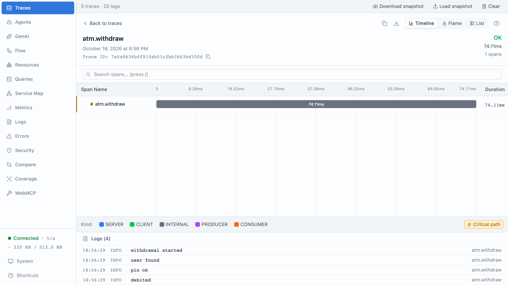
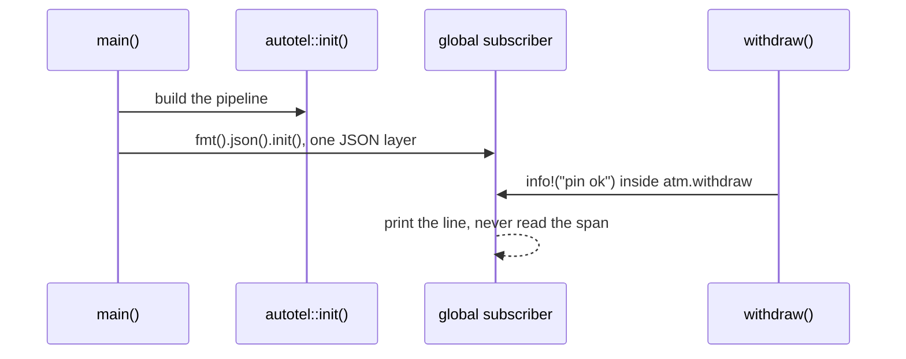
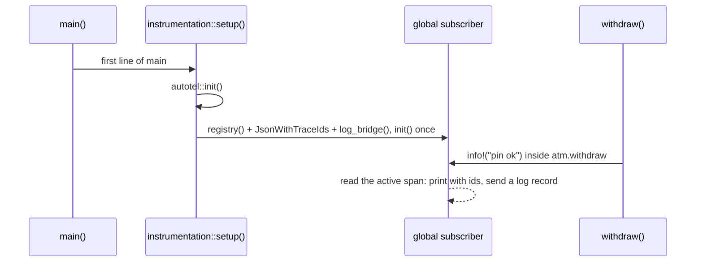

# Part 6: Logs you already have

## The scene

Part 5 gave each withdrawal one wide record. Your team likes it. Then someone
points at the rest of the codebase: four hundred `info!` calls, written with
[`tracing`](https://docs.rs/tracing) over three years, feeding a log search the
support team uses every day.

Nobody is going to delete them. You want each of those lines to say which
withdrawal wrote it, so a support agent who finds `pin ok` in the log search
can jump to that withdrawal's trace.

Part 1 left you in the same place with `println!`: five withdrawals writing
into one stream, and no field saying whose line is whose.

```sh
cargo ex 06
```

## Predict, before you run it

> The exercise calls `autotel::init()` on the first line of `main`, before any
> withdrawal runs, and every withdrawal is traced. The log lines still carry no
> trace id. What did `init()` never get into?

## Your turn

Make every log line carry the `trace_id` and `span_id` of the withdrawal that
wrote it. Do not add either field by hand: the logger calls stay as they are.

Two hints. `autotel` exports `log_bridge()` and `JsonWithTraceIds`. And a part
directory can hold more than one file: `#[path = "instrumentation.rs"] mod
instrumentation;` pulls a sibling file into the binary.

## What you get

```
{"timestamp":"2026-10-21T12:13:23.199212Z","level":"INFO","fields":{"message":"withdrawal started","amount_pence":2000},"target":"ex06"}
{"timestamp":"2026-10-21T12:13:23.199299Z","level":"INFO","fields":{"message":"withdrawal started","amount_pence":4000},"target":"ex06"}
{"timestamp":"2026-10-21T12:13:23.199316Z","level":"INFO","fields":{"message":"withdrawal started","amount_pence":6000},"target":"ex06"}
```

The structure from part 1 is there: JSON, named fields. The identity is not.
Five withdrawals still share one stream, and nothing ties a line to the trace
you built in parts 2 to 5.

## Our solution

```sh
cargo sol 06
```

Move the setup into its own file:

```rust
// instrumentation.rs
use autotel::{AutotelConfig, AutotelRuntime};
use tracing_subscriber::{filter::LevelFilter, fmt, layer::SubscriberExt, util::SubscriberInitExt};

pub fn setup() -> anyhow::Result<AutotelRuntime> {
    // 1. The pipeline: where spans, and now log records, go.
    let telemetry = autotel::init(AutotelConfig::new("atm").devtools())?;

    // 2. The one subscriber, with every layer in it.
    tracing_subscriber::registry()
        .with(fmt::layer().event_format(autotel::JsonWithTraceIds))
        .with(autotel::log_bridge())
        .with(LevelFilter::INFO)
        .init();

    Ok(telemetry)
}
```

Then make it the first thing `main` does, in place of both the `init()` call
and the old logger setup:

```rust
#[path = "instrumentation.rs"]
mod instrumentation;

#[tokio::main]
async fn main() -> anyhow::Result<()> {
    let _telemetry = instrumentation::setup()?;
    // ...the withdrawals, unchanged
}
```

The logger calls in `solution.rs` did not change, and each line now carries
three new fields:

```
{"level":"info","time":1792584804867,"trace_id":"8acd1d26e954b3a85ea460754eb2078d","span_id":"793c208d943ae2be","trace_flags":"01","amount_pence":2000,"msg":"withdrawal started"}
```

Your ids will differ. Copy one `trace_id` into the devtools search box as
`trace_id = "…"` and you land on that withdrawal's trace.



### Why this solution

**A log line reaches the outside world through a subscriber.** `info!` does
not write anything. It hands an event to the process's `tracing` subscriber,
and the subscriber decides what happens: print it, send it somewhere, drop it.
A subscriber is built from _layers_, and each layer sees every event. The
exercise's subscriber had one layer, a JSON printer that knows nothing of
OpenTelemetry, so nothing on the way out read the active span.

**`init()` builds a pipeline and touches nothing else.** It sets up where
spans, metrics and log records go. It does not reach into your logger: Rust
has no way for one crate to rewrite another's functions at load time, and
`autotel` would not want one. So in the exercise, `init()` ran first and the
withdrawals were traced, yet the subscriber that printed every line had been
built without anything from `autotel` in it:



**The global subscriber is set once.** `.init()` installs it for the life of
the process, and there is no adding a layer afterwards. A second `.init()`
panics:

```
failed to set global default subscriber: SetGlobalDefaultError("a global default trace dispatcher has already been set")
```

and `.try_init()` returns that error instead. So you cannot keep the old
logger setup and bolt `autotel` on further down. Every layer has to be in the
one subscriber when it is built.

**`log_bridge()` needs `init()` to have run.** The bridge sends each event to
the log pipeline `init()` built. Build it first and it stops you on the spot:

```
autotel::log_bridge() needs a provider: call autotel::init first
```

That fixes the order: `init()`, then the subscriber with every layer, then the
app. `setup()` holds that order in one place, and `main` calls it before
anything else:



**This is the most common "nothing shows up" bug at work.** The Rust version
of it is a service whose `main` already calls `tracing_subscriber::fmt().init()`
or `env_logger::init()`, with an OpenTelemetry layer added somewhere later, or
in a library that loses the race for the global slot. You get your own spans
from `trace()` and no correlated logs, and if the later setup used `try_init`
and ignored the result, no error to say so. The cure is the same in every Rust
service: one setup function that builds the pipeline and the one subscriber,
called on the first line of `main`.

### Two things the bridge does

1. **It stamps the ids into each line.** `JsonWithTraceIds` prints the same
   facts as before, one JSON object per line, and adds `trace_id`, `span_id`
   and `trace_flags` whenever a span is active. Your log search, whichever you
   use, now has a `trace_id` field on every line. People call this _log
   correlation_: logs and traces can be matched by id.
2. **It sends each line to devtools as a log record.** OpenTelemetry carries
   three kinds of data, called _signals_: traces, metrics and logs. You have
   used traces since part 2, and part 9 covers metrics. `log_bridge()` copies
   each event into a log record, with its trace id, and the exporter sends it
   alongside your spans. `cargo workshop-check 06` confirms that a `pin ok`
   record arrives linked to a trace.

The two are separate layers, so you can keep one without the other: a service
whose log search already works might only stamp the ids, and one with no log
search at all might only send the records.

The book describes where this leads. In Chapter 5, the authors picture a set
of events that all share the same ID, which is what a trace is. With the id on
every line, your logs become more events in that set rather than a separate
pile.

### Where log lines fit next to the wide event

You now have two kinds of record per withdrawal, joined by `trace_id`:

| Record                | How many per withdrawal | Good for                                                      |
| --------------------- | ----------------------- | ------------------------------------------------------------- |
| Wide event (part 5)   | One                     | Filtering and grouping: "refused at bridge-street, over £400" |
| Log lines (this part) | One per step            | Reading the story of one withdrawal in order                  |

Keep writing log lines for the steps a person reads while debugging. Put the
facts you will filter or group on into the wide event, so a question never
needs you to search free text. The trace id means you can move between the
two.

### Using the `log` crate instead

Plenty of crates, and plenty of older services, log through the `log` facade
(`log::info!`) rather than `tracing`. You do not need a second setup for them.
With `tracing-subscriber`'s default `tracing-log` feature, which this workshop
uses, `.init()` also installs a `log` adapter that turns every `log` record
into a `tracing` event. Those events pass through the same layers, so they get
the ids and reach devtools too. The one condition is the same as before:
nothing else may have claimed the global `log` logger first, such as an
`env_logger::init()` left in `main`, or `.init()` panics on that instead.

---

Previous: [Part 5: One wide event per request](../05-one-wide-event/README.md) ·
Next: [Part 7: Errors that explain themselves](../07-errors-that-explain-themselves/README.md)
