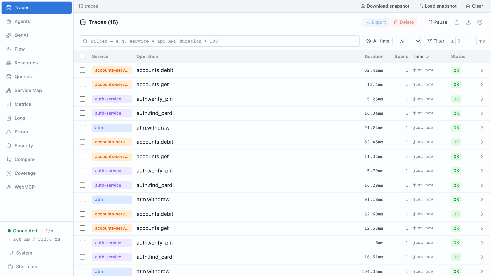
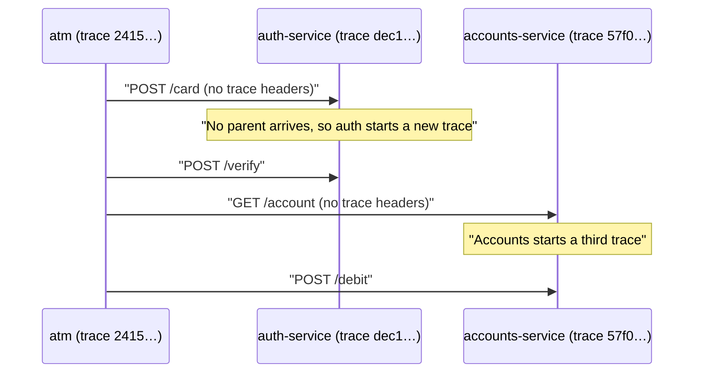
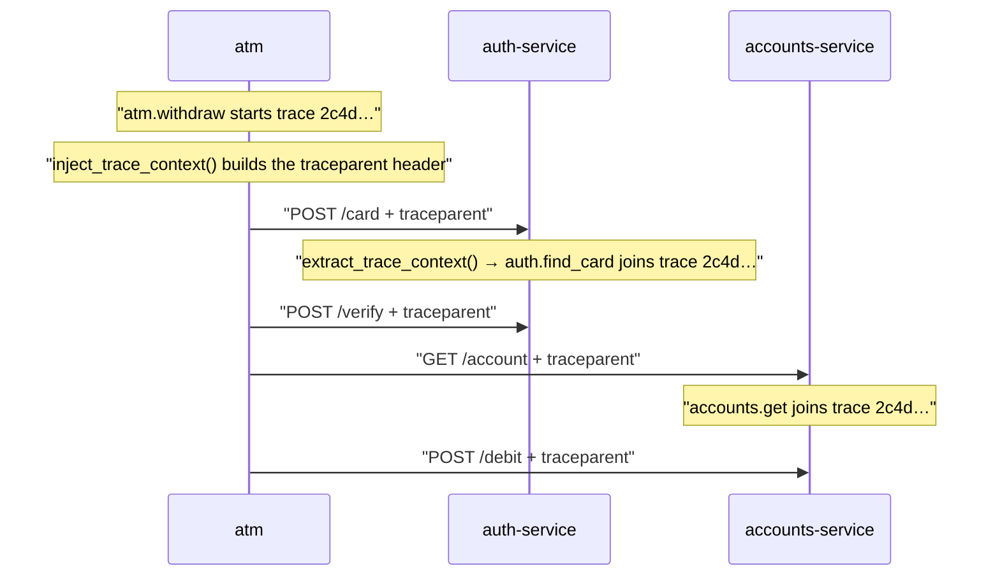
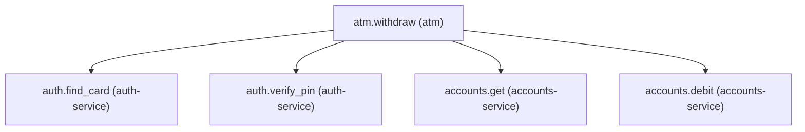
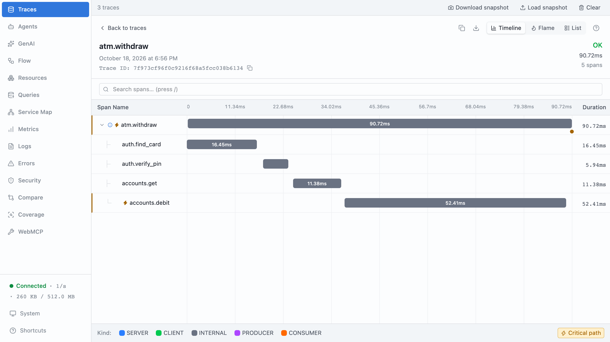
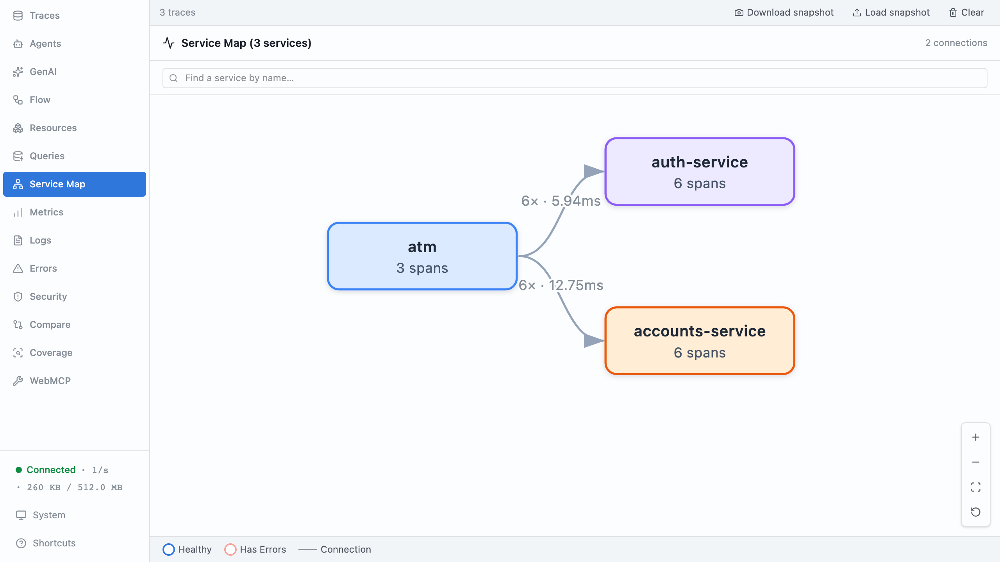
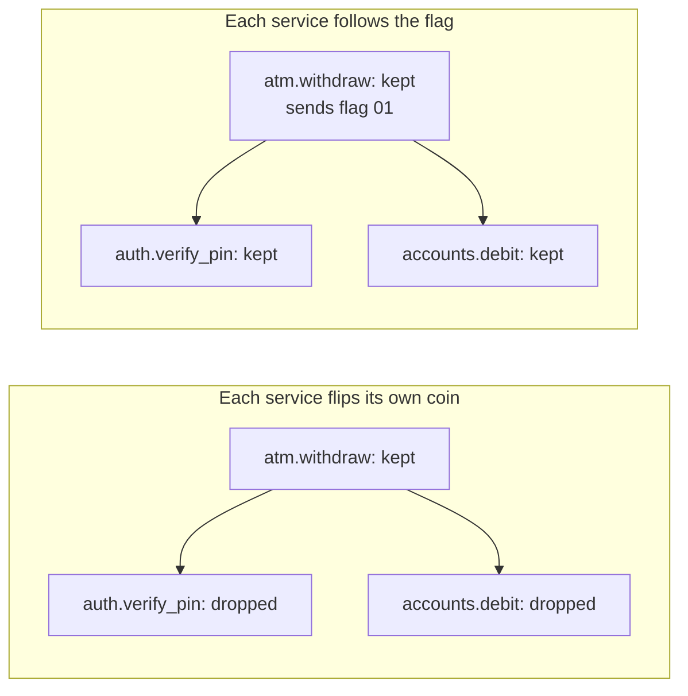

# Part 11: One trace, three services

## The scene

The bank split its one big program, the monolith, into separate services. Auth
runs as its own program now, and so does accounts. The withdrawal still makes
the same four calls in the same order, with the instrumentation you wrote in
part 5.

Then the first slow withdrawal came in, and part 10's method stopped working.

```sh
cargo ex 11
```

The command starts three processes: the ATM, `auth-service` on :7101, and
`accounts-service` on :7102. The two services are small axum servers, each its
own binary (`p11-auth` and `p11-accounts`, built from `services/`). Each one
calls `init()` with its own service name and exports to the same devtools.

A **process** is one running program. Inside one process your code shares
memory, so autotel can pin the active span's context to each future, the name
badge from part 2. A **process boundary** is the gap between two programs.
Think of two offices in different buildings: they share no desk and no filing
cabinet, and each one knows only what arrives in the envelope. Over HTTP, the
envelope is the request.

## Predict, before you run it

> Every service is instrumented. Every service exports to the same place. Every
> service names itself. What, precisely, is missing?

## What you get

```
[atm]              trace 2415d5403ec764dea48d98e95836b5ee
[auth-service]     trace dec1f07d0ea35c3a3f67bc1616907f11
[accounts-service] trace 57f06174aa56f056e10f003a7dee1314
```

One withdrawal produces three trace ids. Devtools shows three unrelated traces,
and you have no path from the slow one to the reason.





The network split one withdrawal into three records, and none of them knows the
other two exist.

## Your turn

Make one withdrawal produce one trace.

Two functions in the `autotel` crate do the job. Find them, and work out which
one belongs on the caller and which on the receiver. The services live in
`services/`, and you may edit them: `cargo ex 11` rebuilds them before it
starts them, so your change is the one that runs.

## Our solution

```sh
cargo sol 11
```

On the way out, in the ATM:

```rust
use autotel::inject_trace_context;

let headers = inject_trace_context();
http.post(format!("{AUTH}/card"))
    .headers(headers.clone())
    .json(&json!({ "card": card_number }))
    .send()
    .await?;
```

On the way in, in each service, one axum middleware around the whole router:

```rust
use autotel::{FutureExt, extract_trace_context};

async fn with_caller_context(request: Request, next: Next) -> Response {
    let incoming = extract_trace_context(request.headers());

    next.run(request).with_context(incoming).await
}

let app = Router::new()
    .route("/card", post(card))
    .route("/verify", post(verify))
    .layer(middleware::from_fn(with_caller_context));
```

That, plus `.baggage("")` in `init()` which part 12 uses, is the whole
difference between `services/` and `services-propagated/`. Diff them.

```
[atm]              trace 2c4d545da246763446577080ea19d8fa
                   traceparent: 00-2c4d545da246763446577080ea19d8fa-47370c86796d05ee-01
[auth-service]     trace 2c4d545da246763446577080ea19d8fa
[accounts-service] trace 2c4d545da246763446577080ea19d8fa
```



You get one trace with five spans across three services, and part 10's method
works again:



The ATM calls `inject_trace_context()` once, while `atm.withdraw` is the active
span, and sends the same headers on all four calls. (`.headers()` takes the
`HeaderMap` by value, hence the `.clone()` on the first three.) That makes all
four service spans direct children of `atm.withdraw`.

### Why this solution

**Propagation** means carrying the trace identity from one piece of work to the
next, so the next piece knows which trace it belongs to. _Observability
Engineering_ (Chapter 7) names two kinds:

> **Interprocess propagation**: The identity crosses process boundaries, often
> via HTTP headers using W3C TraceContext that include trace ID, parent span ID,
> plus optional baggage (arbitrary key-value pairs) set earlier in a transaction.
>
> **Intraprocess propagation**: The identity flows through methods, threads,
> coroutines, or components inside a process boundary.

You have had intraprocess propagation since part 2. OpenTelemetry's `Context`,
attached to each future, carried the active span, and child spans nested
without anyone naming their parent. Nothing carries it across a process
boundary unless you write it into the message.

**One HTTP header carries the missing identity.** It works like a case number
at a call centre. When an agent transfers you, you read the number out, and the
next department adds its notes to your case instead of opening a new one.
**W3C Trace Context** is the standard that defines the header, and the header is
called `traceparent`:

```
traceparent: 00-2c4d545da246763446577080ea19d8fa-47370c86796d05ee-01
```

Hyphens split it into four fields. The ids are written in **hex**
(hexadecimal): digits 0 to 9 plus letters a to f, two characters per byte.

| Field          | Value in this run                  | Meaning                                                                                       |
| -------------- | ---------------------------------- | --------------------------------------------------------------------------------------------- |
| version        | `00`                               | The format version. Every service today sends `00`.                                           |
| trace id       | `2c4d545da246763446577080ea19d8fa` | 32 hex characters naming the whole withdrawal. Each service copies it unchanged.              |
| parent span id | `47370c86796d05ee`                 | 16 hex characters naming the span that made the call, here `atm.withdraw`.                    |
| flags          | `01`                               | `01` means the caller is recording this trace, so record yours too. `00` means it dropped it. |

The receiving service creates its own span, gives it the same trace id, and
records `47370c86796d05ee` as its parent. That one step puts `auth.find_card`
under `atm.withdraw` in the waterfall. No vendor owns the format, so a Java,
Python or Node service that reads `traceparent` joins your trace without
agreeing on anything else.





**The last field carries a sampling decision.** A busy system keeps a fraction
of its traces and drops the rest to control cost. That choice is called
**sampling**, and part 12 covers it in depth. In **head-based sampling**, the
service that starts the trace decides, and the book (Chapter 15) describes what
happens next:

> That decision is then propagated further downstream (e.g., by inserting a
> “guarantee sample retention” header bit) to ensure that every span necessary
> to complete the trace is sampled.

The `01` at the end of `traceparent` is that bit. Picture each service instead
flipping its own coin, keeping 1 trace in 10. The ATM keeps a withdrawal, auth
drops its half of the same withdrawal, and accounts keeps its spans for a
different one. You end up with fragments: an `accounts.debit` span with no
parent, or an `atm.withdraw` with holes where its children belong. When each
service follows the caller's flag, the whole trace survives or none of it does.
The book calls this **consistent sampling**. OpenTelemetry's default sampler
works this way, in Rust as everywhere else: the SDK's default is
`ParentBased(AlwaysOn)`, so when a request arrives with a `traceparent`, the
service copies the caller's decision instead of making its own.



**Inject on the way out, extract on the way in.** To **inject** is to write the
active context into an outgoing message: the case number goes on the envelope.
To **extract** is to read it back off an incoming message.

- `inject_trace_context()` reads the active span and returns the headers, as an
  `http::HeaderMap` that reqwest takes as it is.
- `extract_trace_context(request.headers())` reads those headers and returns an
  OpenTelemetry `Context`. `.with_context(incoming)` attaches it to the
  handler's future, the same `FutureExt` that pinned the badge to a spawned
  task in part 2, and the same way `trace()` makes a span active for
  everything inside it. Each span the service starts then finds a parent, even
  though the parent lives in another process. Doing it in middleware means
  every route gets it, including any you add later.

**HTTP is one carrier among many.** A **carrier** is whatever holds the context
on its trip. Here it is HTTP headers. Elsewhere it is a header on a queue
message (Kafka, RabbitMQ), gRPC metadata (gRPC's version of headers), or a
`TRACEPARENT` environment variable handed to a child process or CI job. The
idea is the same everywhere; only the carrier changes. autotel's two functions
speak `HeaderMap`, so for another carrier you copy the `traceparent` (and
`baggage`) values out of the map on one side and build a `HeaderMap` from them
on the other. OpenTelemetry's own propagator API takes any carrier directly.

A queue changes one thing. The consumer may pick the message up minutes after
the publisher finished, so the context has to live in the message itself. Part
2 met the in-process version of this: a job handed to a background task loses
its badge unless the job carries it. The book (Chapter 7) connects the two
with a **span link** instead of a parent. A link says "this work was caused by
that span over there" without claiming that one waited for the other. A
consumer that handles a batch of 50 messages can link to all 50 publishers at
once.

**Use HTTP instrumentation in a real service.** Tower middleware for axum and
middleware for reqwest can inject and extract for you, and record a span per
request besides. Write the two calls by hand once anyway, because you will
debug a broken trace one day, and the bug takes one of three shapes: the caller
did not inject, the receiver did not extract, or a **proxy** in the middle (a
load balancer or gateway that forwards requests) dropped the header.

**Keep secrets out of the URL.** HTTP instrumentation records the request URL on
the span, in attributes such as `url.full`, so a PIN in a query string would
land in your telemetry. The ATM sends the card number and PIN in the POST body,
which auth reads with axum's `Json` extractor into its `CardBody` struct. The
user id and amount stay in the URL because neither is a secret.

**Decide where `traceparent` goes.** It tells the receiver your trace id. Send
it to your own services, and only to a third party on purpose.

### Check your understanding

Break it on purpose. Remove `.headers(...)` from one of the four requests in
`solution.rs` and run it again. Four spans stay in one trace, and the fifth sits
alone in a trace of its own. You will meet a partially propagated system like
this far more often than one with no propagation at all.

> If a run dies halfway, its two services can be left running, and the next run
> refuses to start: `port 7201 is already in use`. The message tells you the
> fix: `lsof -ti tcp:7201 | xargs kill`.

---

Previous: [Part 10: Finding the cause](../10-finding-the-cause/README.md) ·
Next: [Part 12: Facts that travel](../12-facts-that-travel/README.md)
